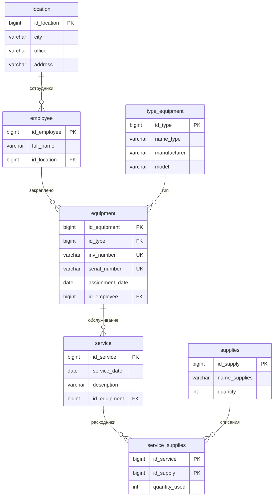

# EquipmentTracker — учёт ИТ-оборудования

Веб-приложение для учёта ИТ-оборудования, сотрудников, локаций, обслуживания и расходников. Интерфейс построен на Filament 4, полностью русифицирован и использует собственную тему оформления.

## Возможности

- Учёт оборудования с инвентарными и серийными номерами.
- Закрепление оборудования за сотрудниками и локациями.
- Справочник типов оборудования: производитель, модель.
- Учёт обслуживания с указанием использованных расходников.
- Автоматическое списание расходников со склада при обслуживании.
- Контроль остатков: нельзя списать больше, чем есть на складе.
- Возврат расходников на склад при отвязке или удалении обслуживания.
- Импорт и экспорт CSV для оборудования, сотрудников, локаций, типов оборудования, расходников и обслуживаний.
- Дашборд со статистикой и графиком обслуживаний.
- Светлая и тёмная темы.
- Полностью русский интерфейс, даты в формате `дд.мм.гггг`.

## Стек

| Компонент | Версия |
|---|---|
| PHP | 8.3+ |
| Laravel | 13.x |
| Filament | 4.x |
| База данных | SQLite по умолчанию, возможны PostgreSQL/MySQL |
| Frontend | Vite, Tailwind CSS 4 |
| Тесты | PHPUnit 12 |
| Форматирование | Laravel Pint |

## Требования

- PHP 8.3 или новее с расширениями `pdo_sqlite` (или `pdo_mysql`/`pdo_pgsql`), `mbstring`, `openssl`, `tokenizer`, `xml`, `ctype`, `json`, `fileinfo`.
- Composer 2.
- Node.js `^20.19.0` или `>=22.12.0` и npm.
- Свободный порт `8000` для локального сервера (можно изменить).

Проверить версии:

```bash
php -v
composer -V
node -v
npm -v
```

## Быстрый старт

```bash
git clone <url-репозитория> EquipmentTracker
cd EquipmentTracker

# Установка зависимостей, создание .env и SQLite-базы, миграции, сборка фронтенда
composer run setup

# Демонстрационные данные: пользователь, оборудование, сотрудники, обслуживания
php artisan db:seed

# Запуск сервера, очереди и Vite
composer run dev
```

После запуска приложение доступно по адресу:

- Приложение: `http://localhost:8000`
- Админ-панель: `http://localhost:8000/admin`

Корневой маршрут `/` перенаправляет в админ-панель.

### Демо-доступ

```
E-mail: test@example.com
Пароль: password
```

> Данные создаются только для локальной разработки. Перед публикацией в продакшене смените пароль и отключите демо-сидер.

### Ручная установка

Если не хотите использовать `composer run setup`:

```bash
composer install
cp .env.example .env
php artisan key:generate

# SQLite-файл не хранится в git
touch database/database.sqlite

php artisan migrate
php artisan db:seed

npm install
npm run build

php artisan serve
```

В отдельном терминале для разработки:

```bash
npm run dev
```

### Пересоздание базы с демо-данными

```bash
php artisan migrate:fresh --seed
```

Команда удаляет все таблицы, заново применяет миграции и заполняет базу демонстрационными данными.

## Переменные окружения

Основные параметры в `.env`:

```dotenv
APP_NAME="ИТ-Учёт"
APP_ENV=local
APP_URL=http://localhost:8000
APP_LOCALE=ru
APP_FALLBACK_LOCALE=ru
APP_FAKER_LOCALE=ru_RU

DB_CONNECTION=sqlite
```

Для SQLite база находится в `database/database.sqlite` и не попадает в git. Для PostgreSQL или MySQL измените блок `DB_*` и создайте базу вручную.

После изменения `.env` при необходимости очистите кеш конфигурации:

```bash
php artisan config:clear
```

## Демонстрационные данные

`DemoDataSeeder` создаёт:

- 5 локаций;
- 15 сотрудников;
- 10 типов оборудования;
- 10 расходников;
- 30 единиц оборудования: 20 выданных сотрудникам и 10 на складе;
- 25 записей обслуживания;
- связи обслуживаний с расходниками.

Сидер не является идемпотентным: повторный `php artisan db:seed` добавит ещё один набор данных.

## Импорт и экспорт CSV

Кнопки **«Импорт CSV»** и **«Экспорт CSV»** доступны на страницах соответствующих ресурсов.

### Экспорт

- Формат: CSV (UTF-8, разделитель — запятая).
- Экспорт выполняется через очередь и завершается уведомлением со ссылкой на скачивание.
- Можно выбрать набор колонок в модальном окне.
- Экспортируются все записи, соответствующие текущим фильтрам и поиску таблицы.

Поддерживается для:

- оборудования;
- сотрудников;
- локаций;
- типов оборудования;
- расходников;
- обслуживаний (включая сводку использованных расходников).

### Импорт

- Формат: CSV (UTF-8, первая строка — заголовки).
- Перед импортом можно скачать пример CSV со всеми доступными колонками.
- Колонки CSV сопоставляются с полями вручную.
- По умолчанию существующие записи обновляются; это можно отключить чекбоксом «Обновлять существующие записи».
- Некорректные строки не прерывают импорт: их можно скачать отдельным CSV с описанием ошибок.

Колонки импорта:

| Сущность | Колонки |
|---|---|
| Локации | `city`, `office`, `address` |
| Сотрудники | `full_name`, `city`, `office`, `address` (адрес нужен только для создания новой локации) |
| Типы оборудования | `name_type`, `manufacturer`, `model` |
| Расходники | `name_supplies`, `quantity` |
| Оборудование | `inv_number`, `serial_number`, `name_type`, `manufacturer`, `model`, `full_name`, `assignment_date` |
| Обслуживания | `equipment_inv_number`, `service_date`, `description` |

Особенности:

- даты принимаются в форматах `дд.мм.гггг`, `дд/мм/гггг` и `гггг-мм-дд`;
- при импорте оборудования тип создаётся автоматически, если его ещё нет;
- сотрудник должен существовать заранее — иначе строка попадёт в CSV ошибок;
- при импорте обслуживаний расходники **не списываются** со склада: для этого используйте создание или редактирование обслуживания в интерфейсе;
- для обработки импорта и экспорта должен быть запущен воркер очереди (`php artisan queue:work` или `composer run dev`).

## Структура базы данных



### Таблицы

| Таблица | Назначение |
|---|---|
| `location` | Локации: город, офис, адрес |
| `employee` | Сотрудники организации. Отдельная таблица, не путать с `users` для аутентификации |
| `type_equipment` | Справочник типов оборудования: название, производитель, модель |
| `equipment` | Единицы оборудования: инвентарный и серийный номера, тип, сотрудник, дата выдачи |
| `supplies` | Расходники и их остаток на складе |
| `service` | Записи обслуживания оборудования |
| `service_supplies` | Pivot-таблица: какие расходники и в каком количестве использованы при обслуживании |

Особенности схемы:

- используются явные имена первичных ключей (`id_equipment`, `id_employee` и т.д.);
- `equipment.inv_number` и `equipment.serial_number` уникальны;
- `service_supplies` имеет составной первичный ключ `(id_service, id_supply)`;
- внешние ключи настроены на `restrict`, `cascade` или `set null` в зависимости от сущности;
- на остатки действуют ограничения `quantity >= 0` и `quantity_used > 0`.

## Бизнес-логика списания расходников

Логика реализована в pivot-модели `App\Models\ServiceSupply` и работает как через Filament, так и при прямых вызовах Eloquent:

| Действие | Результат |
|---|---|
| Добавление расходника к обслуживанию | Проверка остатка и списание `quantity_used` |
| Увеличение `quantity_used` | Списание разницы |
| Уменьшение `quantity_used` | Возврат разницы на склад |
| Отвязка расходника | Возврат всего израсходованного количества |
| Удаление обслуживания | Возврат всех связанных расходников |

Все изменения выполняются в транзакции с блокировкой строки расходника. При нехватке остатка выбрасывается ошибка валидации, а изменения откатываются.

Расходники можно выбрать:

- при создании обслуживания — блок «Использованные расходники» в форме;
- при редактировании — через relation manager «Расходники».

## Интерфейс

- Русская локаль Laravel и Filament.
- Собственная тема Filament: индиго-фиолетовая палитра, градиентный фон, тёмная боковая панель, стеклянные карточки, скругления и мягкие тени.
- Логотип и favicon `public/images/`.
- Навигация сгруппирована:
  - **Учёт** — оборудование и сотрудники;
  - **Склад** — расходники;
  - **Сервис** — обслуживания;
  - **Справочники** — локации и типы оборудования.
- Дашборд «Обзор»: карточки статистики и график обслуживаний за последние 6 месяцев.
- Поддержка светлой и тёмной темы.

Исходники темы: `resources/css/filament/admin/theme.css`.

После изменения темы или стилей пересоберите фронтенд:

```bash
npm run build
```

## Тесты

```bash
php artisan test
# или
composer test
```

Покрыты:

- целостность внешних ключей;
- уникальность инвентарных и серийных номеров;
- ограничения остатков;
- списание, корректировка и возврат расходников;
- создание обслуживания с расходниками;
- откат при нехватке остатка;
- импорт всех сущностей и разрешение связей;
- экспорт CSV-колонок и связанных данных.

Сейчас в проекте 35 тестов.

Форматирование кода:

```bash
vendor/bin/pint
```

## Структура проекта

```text
app/
├── Filament/
│   ├── Exports/                     # экспортёры CSV
│   ├── Imports/                     # импортёры CSV
│   ├── Pages/Dashboard.php          # страница «Обзор»
│   ├── Resources/                   # CRUD-ресурсы Filament
│   └── Widgets/                     # статистика и график
├── Models/                          # Eloquent-модели и pivot ServiceSupply
└── Providers/
    ├── AppServiceProvider.php
    └── Filament/AdminPanelProvider.php

database/
├── factories/                       # фабрики демо-данных
├── migrations/                      # схема БД
└── seeders/                         # DatabaseSeeder и DemoDataSeeder

lang/ru/                             # русские переводы Laravel
resources/css/filament/admin/        # кастомная тема Filament
public/images/                       # логотип и favicon
tests/Feature/                       # feature-тесты
routes/web.php                       # редирект / -> /admin
```

## Полезные команды

```bash
composer run dev             # сервер + очередь + логи + Vite
php artisan serve            # только Laravel-сервер
php artisan queue:work       # воркер очереди для импорта/экспорта
npm run dev                  # только Vite
npm run build                # production-сборка фронтенда
php artisan migrate          # применить миграции
php artisan db:seed          # демо-данные
php artisan migrate:fresh --seed  # пересоздать БД с демо-данными
php artisan test             # тесты
vendor/bin/pint              # форматирование PHP
```

## Ограничения

- Нет ролей и разграничения прав: любой авторизованный пользователь имеет полный доступ к панели.
- Нет журнала движений склада: хранится текущий остаток и количество, использованное в обслуживаниях.
- Демо-сидер не идемпотентен.
- Панель одна; отдельного API или клиентского приложения нет.

## Возможные направления развития

- Роли и политики доступа.
- Журнал движений склада (приход, списание, возврат).
- Статусы оборудования: на складе, выдано, в ремонте, списано.
- Уведомления о низком остатке расходников.
- Импорт и экспорт оборудования и расходников.
